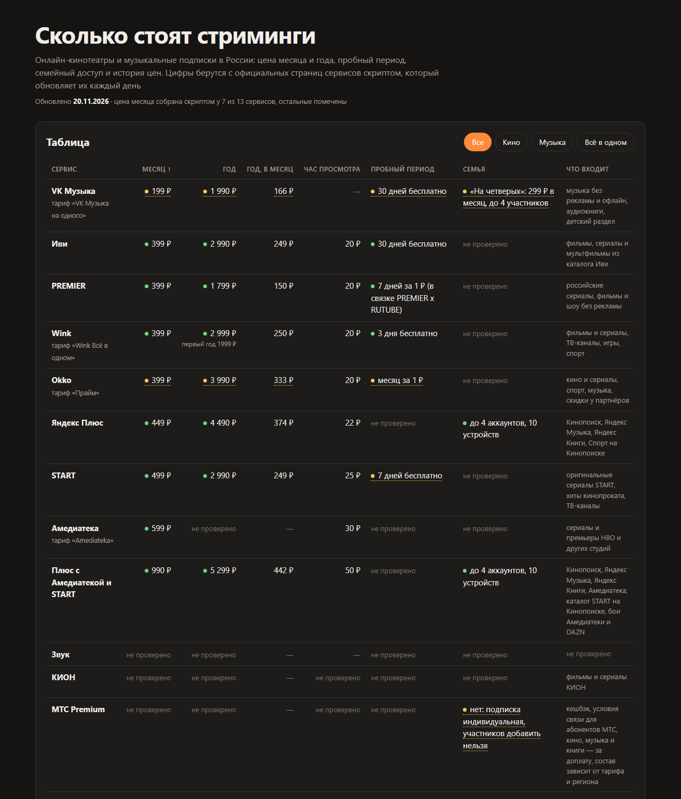

# Сколько стоят стриминги

**[Открыть сайт → kochurin.github.io/streaming-rating](https://kochurin.github.io/streaming-rating/)**

Цены российских онлайн-кинотеатров и музыкальных подписок в одной таблице: месяц, год, пробный период, семейный доступ и история изменений. Цифры собирает скрипт с официальных страниц сервисов, каждый день, через GitHub Actions



## Что на сайте

- Таблица с сортировкой по любой колонке и фильтрами «Кино», «Музыка», «Всё в одном»
- Годовая цена в пересчёте на месяц и цена часа просмотра под ваши часы
- Калькулятор «что дешевле под мои привычки»: сколько часов смотрите, нужна ли музыка, платите помесячно или за год, сколько человек в семье. Он сравнивает отдельные подписки и пары «кино + музыка»
- График истории цен. Точка добавляется, когда скрипт видит новую цену. История копится с 20.11.2026, задним числом ничего не дорисовано

У каждой цифры есть метка. Зелёная точка: собрано скриптом в день обновления. Жёлтая: сверено вручную, дата в подсказке. «Не проверено»: значения нет, и выдумывать его не стали

## Откуда цифры

| Сервис | Источник | Как собирается |
|---|---|---|
| Яндекс Плюс и «Плюс с Амедиатекой и START» | [таблица тарифов в справке Яндекса](https://yandex.ru/support/plus-ru/ru/types) | скрипт |
| Иви | [страница подписок ivi.ru](https://www.ivi.ru/profile/subscriptions) | скрипт |
| PREMIER | [premier.one](https://premier.one/) | скрипт |
| Wink | [витрина подписок wink.ru](https://wink.ru/services) | скрипт |
| START | [документ «Стоимость подписки»](https://start.ru/legal/subscription_price) (PDF) | скрипт |
| Амедиатека | [карточка приложения в App Store](https://apps.apple.com/ru/app/id695094274), встроенные покупки | скрипт |
| Okko | [okko.tv/subscriptions](https://okko.tv/subscriptions) | сверено вручную: страница закрыта антибот-защитой, обходить её не стали |
| VK Музыка | [music.vk.com](https://music.vk.com/) | сверено вручную: цены подгружаются скриптом страницы |
| КИОН, МТС Premium, СберПрайм, Звук | официальные сайты | не проверено: цена видна только после входа или страница не открылась |

Сейчас скрипт собирает цену месяца у 7 сервисов из 13. Ручные цифры через 60 дней сами становятся «не проверено». Если страница сервиса перестала отдавать цену, в таблице остаётся последнее собранное значение с датой и пометкой, а свежим оно не считается

Промо и цены для новых пользователей в таблицу не попадают, кроме пробного периода. У операторов, банков и в связках подписки бывают дешевле

## Как устроено

```
data/services.json   справочник: что входит, теги, ручные сверки с датой и ссылкой
data/prices.json     последние собранные цены со статусом каждого поля
data/history.json    история: точка на каждое изменение цены
data/bundle.js       те же данные для сайта, чтобы index.html открывался без сервера
scraper/             сборщик на Python: requests и pypdf
index.html, assets/  статичный сайт без сборки и фреймворков
.github/workflows/   ежедневный запуск сборщика и коммит изменений
```

Каждое поле в `prices.json` выглядит так:

```json
"month": { "value": 399, "status": "auto", "checked": "2026-11-20", "source": "https://premier.one/" }
```

`status` бывает `auto` (собрано сейчас), `manual` (сверено руками), `stale` (раньше собиралось, сейчас нет) и `unverified`

## Запустить у себя

```bash
pip install -r scraper/requirements.txt
python scraper/scrape.py
```

Сайт открывается двойным щелчком по `index.html`. Если удобнее через сервер:

```bash
python -m http.server 8000
```

и откройте http://localhost:8000

## GitHub Actions и Pages

Workflow `.github/workflows/scrape.yml` запускается каждый день в 07:17 по Москве и вручную из вкладки Actions. Если цены изменились, он коммитит папку `data/`

Сайт публикуется через GitHub Pages: Settings → Pages → Deploy from a branch → `main`, папка `/ (root)`

Серверы GitHub находятся за границей, и часть российских сайтов может отвечать им иначе, чем из России. Тогда поле станет «не проверено» или «последнее известное», а не получит случайное число. Чтобы собирать из России, workflow можно перевести на свой self-hosted runner

## Как добавить сервис

1. Допишите сервис в `data/services.json`: `id`, название, теги `kino`, `music`, `all`, ссылку и что входит, со ссылкой на источник
2. Если цена есть на открытой официальной странице, добавьте функцию в `scraper/parsers.py` и строку в словарь `PARSERS`
3. Если цены на открытой странице нет, заполните блок `manual` с датой сверки и ссылкой. Без даты и ссылки ручные цифры не принимаются

Нашли ошибку или знаете официальную страницу с ценой — откройте issue

## Ещё проекты

- [Что у меня заблокировано](https://kochurin.github.io/blockcheck/): какие сервисы не открываются в вашей сети
- Что посмотреть сегодня: Telegram-канал [@filmy_segodnya](https://t.me/filmy_segodnya)

## Лицензия

MIT. Данные о ценах принадлежат сервисам, проект только собирает публичную информацию и ссылается на источник
